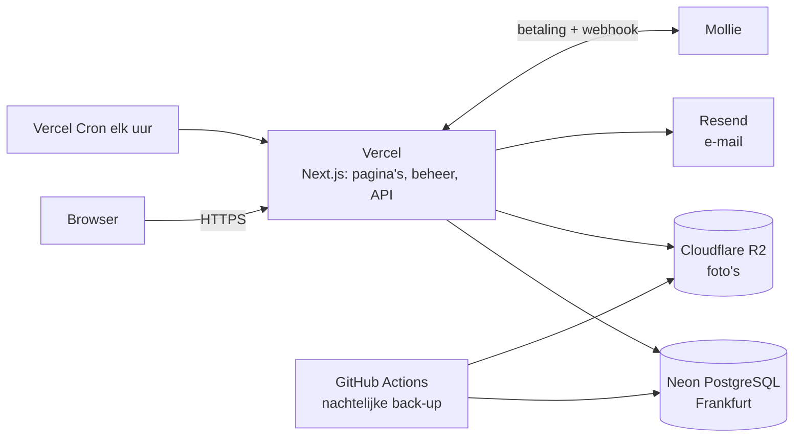

# MazdaClub Nederland

Website, webshop en ledenplatform voor **MazdaClub Nederland**, de landelijke Mazda-vereniging (opgericht in 2025).
Wit met Mazda-rood (`#C00000`), volledig responsive, SEO-vriendelijk en AVG-proof. Alles is te beheren via een
gebruiksvriendelijk beheerpaneel, zonder code aan te passen.

## Functionaliteit

| Onderdeel | Wat het doet |
| --- | --- |
| **Homepagina** | Wisselende welkomstfoto's met CTA's, kerncijfers die automatisch meegroeien (leden, evenementen), over de club, activiteiten, blok **Maandelijkse Mazda Meetings** met de eerstvolgende meeting, ledenvoordelen, foto's van ritten, agenda, laatste nieuws, uitgelichte producten |
| **Evenementen** | Agenda met datum, locatie, opgemaakte beschrijving, beschikbare plaatsen en foto. Inschrijven: **leden gratis, niet-leden € 5,00**. Na aanmelding direct **"Zet in je agenda"** (Google, Apple, Outlook, .ics) en een bevestigingsmail met agendabijlage |
| **Nieuws** | Nieuwsberichten met teksteditor, coverfoto en inplannen; de drie nieuwste op de homepagina |
| **Lidmaatschap** | € 50 per jaar, aanmelden met direct een account, online betalen, jaarlijkse automatische verlenging (Mollie-abonnement) of handmatig verlengen |
| **Webshop** | Categorieën, zoeken, filters, varianten (maat/kleur), voorraadbeheer, winkelwagen, verzendopties, bestelgeschiedenis en automatisch 25% ledenkorting |
| **Fotogalerij** | Albums per evenement, lichtbox met zoom en download, automatische beeldoptimalisatie (WebP, GPS verwijderd) |
| **Mijn Account** | Profiel, digitale ledenpas, lidmaatschap, bestellingen, inschrijvingen met agendaknoppen, gegevens downloaden en account verwijderen (AVG) |
| **Beheerdermodus** | De eigenaar (`OWNER_EMAIL`) krijgt na bevestiging van het e-mailadres automatisch beheerdersrechten en gebruikt de site verder gewoon; de knop **Beheerdermodus** geeft toegang tot al het beheer |
| **Beheer** | Dashboard, meldingencentrum, evenementen + deelnemers + Excel/CSV, nieuws, fotoalbums, producten en voorraad, bestellingen + pakbon + verzendlijst, **gebruikers & leden** (alle accounts, betaald lid maken, betaallink sturen, rollen), betalingen (incl. terugbetalen), **Teksten & afbeeldingen** en een ingebouwde **Hulp & uitleg** |
| **Instellingen** | Alles zonder code: betaalkoppeling (Mollie/Stripe, sleutels versleuteld, verbinding testen, IBAN), lidmaatschapsprijs en ledenkorting, verzendadres en -kosten (voorbereid op Sendcloud/MyParcel), e-mail via Resend of eigen mailserver (testmail), meldingen per gebeurtenis |
| **Accounts** | Gratis account met e-mailbevestiging; op ieder moment op hetzelfde account upgraden naar betaald lid |
| **Betalingen** | Mollie (aanbevolen) met iDEAL \| Wero, Bancontact, creditcard, Apple Pay, Google Pay en PayPal; Stripe optioneel; lokale testmodus |
| **Veiligheid & AVG** | bcrypt-wachtwoorden, rolgebaseerde toegang, rate limiting, honeypot + optioneel Cloudflare Turnstile, cookiebanner, privacyverklaring, algemene voorwaarden, security headers |

## Techniek

Next.js 15 (App Router) · React 19 · TypeScript · Tailwind CSS 4 · shadcn/ui (Radix) · Tiptap-teksteditor · PostgreSQL · Prisma 6 · Auth.js v5 · Mollie / Stripe · Resend · Cloudflare R2 / AWS S3 · sharp



Een eigen server (VPS met Docker) blijft ook mogelijk; zie [DEPLOYMENT.md](docs/DEPLOYMENT.md).

## Snel starten (lokaal)

```powershell
npm install
Copy-Item .env.example .env      # vul AUTH_SECRET en DATABASE_URL in
npx prisma migrate deploy
npm run db:seed                  # schone start: alleen webshopcategorieën + lokale testbeheerder
npm run dev
```

Open <http://localhost:3000> (beheer: <http://localhost:3000/admin>). De lokale testbeheerder en het testwachtwoord staan bovenaan [`prisma/seed.ts`](prisma/seed.ts).
De website start **leeg, zonder voorbeelddata**. Wil je lokaal alle schermen met fictieve inhoud zien, gebruik dan `npm run db:demo`; met `npm run db:fresh` ga je terug naar een schone start.

## Documentatie

1. **[De website online zetten – stappenplan in gewone taal](docs/WEBSITE-ONLINE-ZETTEN.md)** (publiceren, domein koppelen, later wijzigen)
1. [Livegang, hosting, domein, kosten, back-ups en updates (technisch)](docs/DEPLOYMENT.md)
2. [Installatiehandleiding (lokaal)](docs/INSTALLATIE.md)
3. [Databaseschema](docs/DATABASE.md) en [ERD-diagram](docs/ERD.md)
4. [Mappenstructuur](docs/MAPPENSTRUCTUUR.md)
5. [API-overzicht](docs/API.md) – alle routes en server actions
6. Handleiding voor beheerders: in de website zelf onder **Beheer → Hulp & uitleg** (`/admin/hulp`)

## Opmerkingen

- **Beeldmateriaal:** zolang er geen eigen foto's zijn geüpload, toont de site rechtenvrije sfeerbeelden van [Unsplash](https://unsplash.com). Ze zijn in het beheer gemarkeerd als "Tijdelijke foto" en met één klik te vervangen.
- **Logo:** het officiële clublogo (zwart en wit) staat in `public/images/logo/` en is standaard ingesteld; het favicon is afgeleid van de "M" uit het logo. Vervangen kan via Beheer → Teksten & afbeeldingen → Logo & afbeeldingen.
- **Merk:** stem het gebruik van de merknaam Mazda af met Mazda Nederland; de site vermeldt dat de vereniging onafhankelijk is van Mazda Motor Corporation.
- **Juridische teksten** (privacyverklaring, voorwaarden) zijn een degelijke basis; laat ze vóór livegang controleren door het bestuur.
