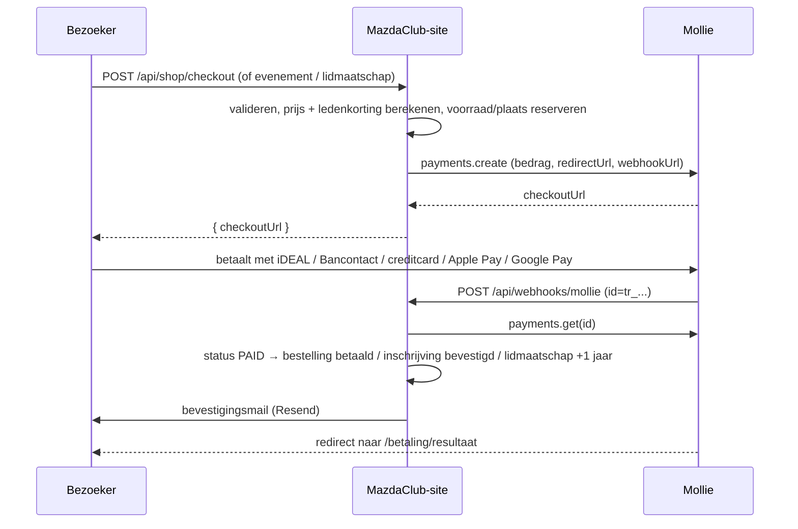

# API-overzicht

De backend bestaat uit **Next.js Route Handlers** (`src/app/api/**/route.ts`) voor alles wat van buitenaf of vanuit client-formulieren wordt aangeroepen, en **Server Actions** voor het beheerpaneel en accountformulieren.

## Conventies

- Verzoeken en antwoorden in JSON (`Content-Type: application/json`), behalve uploads (`multipart/form-data`) en de Mollie-webhook (`application/x-www-form-urlencoded`).
- Fouten: HTTP-statuscode + `{ "error": "Leesbare melding", "fields": { "veld": "melding" } }`. `fields` alleen bij validatiefouten (422).
- Bedragen altijd in **centen**.
- Publieke formulieren sturen botbescherming mee: `website` (honeypot, leeg), `formStartedAt` (timestamp) en optioneel `turnstileToken`.
- Authenticatie via een Auth.js-sessiecookie (JWT). 🔒 = ingelogd, 🛡️ = beheerder.

| Status | Betekenis |
| --- | --- |
| 200 | OK |
| 400 | Ongeldig verzoek / botcontrole mislukt |
| 401 / 403 | Niet ingelogd / geen rechten |
| 404 | Niet gevonden |
| 409 | Conflict (bijv. e-mail bestaat al, dubbele inschrijving, onvoldoende voorraad, evenement vol) |
| 422 | Validatiefout (`fields`) |
| 429 | Te veel verzoeken (rate limit) |

---

## Authenticatie & account

| Methode | Route | Toegang | Beschrijving |
| --- | --- | --- | --- |
| `GET/POST` | `/api/auth/*` | publiek | Auth.js (inloggen met e-mail + wachtwoord, sessie, uitloggen) |
| `POST` | `/api/register` | publiek | Gratis account aanmaken. Body: `firstName, lastName, email, phone?, password, acceptTerms, marketingConsent?` → `{ ok: true, verificationSent }`. Stuurt een welkomst- en bevestigingsmail (link 48 uur geldig) en een melding aan de beheerders. Een account met het eigenaarsadres (`OWNER_EMAIL`) krijgt na bevestiging automatisch beheerdersrechten |
| `GET` | `/e-mail-bevestigen?token=…` | publiek | Pagina: bevestigt het e-mailadres (token gehasht opgeslagen, eenmalig) |
| `POST` | `/api/password/forgot` | publiek | Resetlink mailen. Body: `{ email }` → altijd `{ ok: true }` (geen account-enumeratie) |
| `POST` | `/api/password/reset` | publiek | Nieuw wachtwoord. Body: `{ token, password }` → `{ ok: true }`. Bevestigt ook het e-mailadres (bewijs van eigendom) |
| `GET` | `/api/account/export` | 🔒 | AVG-export van alle eigen gegevens als JSON-download |

## Evenementen

| Methode | Route | Toegang | Beschrijving |
| --- | --- | --- | --- |
| `GET` | `/api/events` | publiek | Komende gepubliceerde evenementen (60 s cache) → `{ events: [{ slug, title, summary, startsAt, endsAt, registrationDeadline, locationName, address, city, capacity, availableSeats, priceNonMember, priceMember, imageUrl, url }] }` |
| `GET` | `/api/events/{slug}/agenda` | publiek | Agendabestand (`.ics`, RFC 5545) van een gepubliceerd evenement voor Apple Agenda, Outlook-app e.d. Tijden in UTC, herinnering 1 dag vooraf. 404 voor concepten/geannuleerd. Google- en Outlook.com-links worden in `src/lib/calendar.ts` gemaakt |
| `POST` | `/api/events/{slug}/register` | publiek | Inschrijven. Body: `firstName, lastName, email, phone, licensePlate, remarks?, acceptTerms` + botvelden. Ingelogd actief lid → gratis: `{ redirectUrl }` en direct een bevestigingsmail. Anders € 5,00: `{ checkoutUrl }` naar de betaalpagina; de bevestigingsmail volgt na betaling. Ledenprijs **alleen** voor een ingelogd actief lid (nooit op basis van een ingetypt e-mailadres). Plaatscontrole in een serialiseerbare transactie. 409 bij vol, gesloten of dubbele inschrijving |

## Lidmaatschap

| Methode | Route | Toegang | Beschrijving |
| --- | --- | --- | --- |
| `POST` | `/api/membership/checkout` | publiek / 🔒 | Lid worden of verlengen (€ 50). Gasten sturen `account: { firstName, lastName, email, phone?, password, street?, houseNumber?, postalCode?, city?, licensePlate?, carModel? }` mee; dan wordt direct een account aangemaakt. Body verder: `autoRenew, acceptTerms` → `{ checkoutUrl }` |
| `POST` | `/api/membership/cancel-renewal` | 🔒 | Automatische verlenging stopzetten (Mollie-abonnement opzeggen); lidmaatschap blijft geldig tot de einddatum → `{ ok: true }` |

## Webshop

| Methode | Route | Toegang | Beschrijving |
| --- | --- | --- | --- |
| `GET` | `/api/shop/products` | publiek | Catalogus. Query: `q`, `categorie`, `sorteer` (`nieuw`, `prijs-op`, `prijs-af`, `naam`), `voorraad=1`, `pagina` → `{ products, total, page, pageSize, pageCount }` |
| `POST` | `/api/shop/quote` | publiek | Prijsopgave van de winkelwagen met actuele prijzen en voorraad uit de database, ledenkorting en verzendkosten. Body: `{ items: [{ variantId, quantity }], shippingMethod? }` → `{ subtotal, discount, shippingCost, total, memberDiscountApplied, isMember, shippingMethod, hasIssues, lines: [{ variantId, name, variantName, unitPrice, finalUnitPrice, quantity, lineTotal, stock, available, reason }] }` |
| `POST` | `/api/shop/checkout` | publiek | Bestelling plaatsen (ook als gast). Body: `items, shippingMethod, firstName, lastName, email, phone?, street, houseNumber, postalCode, city, country, notes?, acceptTerms` + botvelden. Reserveert voorraad atomair → `{ checkoutUrl, orderNumber }`. 409 bij onvoldoende voorraad, 502 als de betaalprovider faalt |

## Contact

| Methode | Route | Toegang | Beschrijving |
| --- | --- | --- | --- |
| `POST` | `/api/contact` | publiek | Body: `name, email, subject, message` + botvelden → `{ ok: true }`. Opgeslagen als contactbericht (zichtbaar in `/admin/berichten`) en gemaild naar de ontvanger uit Beheer → Instellingen (valt terug op `ADMIN_EMAIL` en daarna het zichtbare clubadres), met reply-to naar de afzender |

## Betalingen

| Methode | Route | Toegang | Beschrijving |
| --- | --- | --- | --- |
| `GET` | `/api/payments/{id}` | publiek (onraadbare id) | Actuele status, synchroniseert met de provider → `{ status, type, amount, order? }` |
| `POST` | `/api/webhooks/mollie` | Mollie | Webhook (`id=tr_...`). Status wordt altijd opnieuw bij Mollie opgehaald; verwerkt ook automatische verlengingen van abonnementen |
| `POST` | `/api/webhooks/stripe` | Stripe | Webhook met handtekeningverificatie (`STRIPE_WEBHOOK_SECRET`) |
| `POST` | `/api/payments/mock/{id}` | alleen ontwikkeling | Testbetaling afronden. Body: `{ status: "PAID" \| "FAILED" \| "CANCELED", method? }` |

## Beheer (🛡️)

| Methode | Route | Beschrijving |
| --- | --- | --- |
| `POST` | `/api/admin/upload` | Afbeeldingen uploaden (`multipart/form-data`: `files` (max. 30, max. 15 MB per stuk; de browser verkleint grote foto's vooraf tot < 4 MB), `folder` = `albums` \| `products` \| `events` \| `news` \| `site`, optioneel `albumId`, `replacePhotoId` (precies één bestand: vervangt de afbeelding van die foto, bijschrift en volgorde blijven, oude bestanden worden verwijderd) en `variant=favicon` (alleen `site`: vierkante PNG 512×512)). Map `site` accepteert ook SVG (wordt omgezet naar WebP; de ruwe SVG wordt nooit opgeslagen). Automatisch verkleind naar WebP (max. 2400 px + 640 px thumbnail), EXIF/GPS verwijderd → `{ files: [{ url, thumbUrl, width, height, key, thumbKey, photoId? }], errors?: [{ name, error }] }` |
| `GET` | `/api/admin/export/{type}` | Export naar Excel (`.xlsx`) of CSV (UTF-8 met BOM, `;`-gescheiden, beschermd tegen formule-injectie). `type` = `registrations` \| `orders` \| `shipments` (verzendlijst van betaalde, nog te verzenden bestellingen, voor import in MyParcel/Sendcloud/PostNL) \| `members` \| `payments`; query `format=csv\|xlsx` plus filters: `eventId` (deelnemers), `status` (bestellingen/leden), `q` (leden/betalingen), `type`/`provider` (betalingen). Max. 50.000 rijen |

## Systeem

| Methode | Route | Toegang | Beschrijving |
| --- | --- | --- | --- |
| `GET` | `/api/health` | publiek | Health check (database) voor monitoring en Docker |
| `GET` | `/api/cron/maintenance` | `Authorization: Bearer CRON_SECRET` | Verlopen lidmaatschappen afsluiten, herinneringsmails 30 dagen vóór afloop, verlopen betalingen opruimen (voorraad en plaatsen vrijgeven) |
| `GET` | `/media/{key}` | publiek | Lokaal opgeslagen uploads (alleen bij `STORAGE_DRIVER=local`) |
| `GET` | `/sitemap.xml`, `/robots.txt` | publiek | SEO (sitemap bevat ook nieuwsberichten) |
| `GET` | `/og` | publiek | Standaard deelafbeelding (1200×630) voor social media, zolang er in het beheer geen eigen deelafbeelding is ingesteld |

---

## Server Actions

Server Actions draaien op de server en controleren zelf de rechten (`requireAdmin()` / ingelogde gebruiker) en invoer (Zod), ook al beschermt de middleware de pagina's al.

| Bestand | Acties |
| --- | --- |
| `src/app/actions/auth.ts` | `logout` |
| `src/app/(site)/account/actions.ts` | `updateProfile`, `changePassword` (max. 5 pogingen / 15 min), `deleteAccount` (bevestiging "VERWIJDER"; zegt eerst een Mollie-abonnement op) |
| `src/app/admin/actions/events.ts` | `saveEvent`, `deleteEvent` (geweigerd bij betaalde inschrijvingen), `cancelRegistration`, `confirmRegistration`, `resendRegistrationConfirmation` |
| `src/app/admin/actions/orders.ts` | `updateOrderStatus` (verzonden → mail met track & trace; annuleren → voorraad terug), `updateOrderNotes` |
| `src/app/admin/actions/products.ts` | `saveProduct` (incl. varianten in één transactie), `toggleProductActive`, `deleteProduct`, `createCategory`, `deleteCategory` |
| `src/app/admin/actions/members.ts` | `createMember` (lid handmatig toevoegen, optioneel direct actief lidmaatschap en uitnodigingsmail met link van 7 dagen), `updateMemberProfile`, `sendMemberInvite`, `deleteMember` (bevestiging "VERWIJDER"; zegt eerst het Mollie-abonnement op, bestellingen blijven bewaard), `extendMembership` (handmatig +1 jaar), `setMembershipStatus`, `setUserRole` (laatste beheerder blijft altijd bestaan) |
| `src/app/admin/actions/payments.ts` | `refreshPaymentStatus` |
| `src/app/admin/actions/albums.ts` | `saveAlbum`, `deleteAlbum` (verwijdert ook alle bestanden), `updatePhotoCaption`, `setAlbumCover`, `deletePhoto`, `deletePhotos` (meerdere tegelijk), `movePhoto` |
| `src/app/admin/actions/news.ts` | `saveNews` (inhoud wordt opgeschoond; publiceren, inplannen met datum in de toekomst of concept), `toggleNewsPublished`, `deleteNews` |
| `src/app/admin/actions/messages.ts` | `toggleMessageHandled`, `deleteMessage` |
| `src/app/admin/actions/content.ts` | `saveContent` – slaat de velden van één tabblad van Teksten & afbeeldingen (of Instellingen) op; waarden gelijk aan de standaard worden niet opgeslagen. Definities in `src/lib/content.ts` |
| `src/app/(site)/installatie/actions.ts` | `createFirstAdmin` – eerste beheerdersaccount; vereist `SETUP_CODE` in productie en werkt alleen zolang er geen beheerder bestaat |
| `src/app/(site)/e-mail-bevestigen/actions.ts` | `resendMyVerification` – bevestigingsmail opnieuw sturen (max. 3 per kwartier) |
| `src/app/admin/actions/members.ts` (aanvulling) | `activatePaidMembership` (gebruiker betaald lid maken of verlengen: periode, betaalwijze contant/overboeking/gratis, bedrag → betaling `MANUAL`, bevestigingsmail en melding), `sendMembershipPaymentLink` (mail met link om online te betalen op het eigen account), `markUserEmailVerified`, `resendUserVerification`. De eigenaar kan niet worden gedegradeerd of verwijderd |
| `src/app/admin/actions/payments.ts` (aanvulling) | `refundPaymentAction` – volledig of gedeeltelijk terugbetalen van een Mollie-/Stripe-betaling |
| `src/app/admin/instellingen/betalingen/actions.ts` | `savePaymentSettings` (provider, API-sleutels versleuteld, tenaamstelling en IBAN met controle), `testPaymentConnection` (toont actieve betaalmethoden, test- of live-modus) |
| `src/app/admin/actions/pricing-settings.ts` | `saveMembershipSettings` (lidmaatschapsprijs, ledenkorting, standaardprijzen evenementen, automatische verlenging, herinneringstermijn), `saveShippingSettings` (afzendadres, verzendmethoden en -kosten, verwerkingstijd, verzendplatform met versleutelde sleutels) |
| `src/app/admin/actions/email-settings.ts` | `saveEmailSettings` (Resend of eigen mailserver/SMTP, afzender, antwoordadres, ondertekening), `sendTestEmailAction` |
| `src/app/admin/actions/notification-settings.ts` | `saveNotificationSettings` (ontvangers, meldingen per gebeurtenis aan/uit), `sendTestNotificationAction`, `markNotificationRead`, `markAllNotificationsRead`, `openNotification` |

## Instellingen en meldingen

Instellingen die beheerders zelf aanpassen staan in de tabel `AppSetting` (één JSON-record per onderdeel: `payments`, `membership`,
`shipping`, `email`, `notifications`), gedefinieerd en gevalideerd in `src/lib/settings.ts`. Geheime waarden (API-sleutels,
wachtwoorden) worden versleuteld met AES-256-GCM (`src/lib/crypto.ts`, sleutel afgeleid van `SETTINGS_ENCRYPTION_KEY` of `AUTH_SECRET`)
en nooit naar de browser gestuurd. Volgorde: instelling in het beheer → omgevingsvariabele → standaardwaarde.

Prijzen komen overal uit `getPricing()` (server) of `usePricing()` (client); in beheerbare teksten worden `{lidmaatschapsprijs}`,
`{ledenkorting}`, `{evenementprijs}` en `{gratisverzending}` automatisch vervangen.

`notifyAdmins()` (`src/lib/notifications.ts`) maakt bij elke belangrijke gebeurtenis een melding in het meldingencentrum
(`/admin/meldingen`) en stuurt, als die soort melding aan staat, een e-mail naar de ontvangers: nieuw account, nieuw of verlengd lid,
verlopen lidmaatschap, aanmelding voor een rit/evenement, betaalde bestelling, contactbericht, mislukte betaling en terugbetaling.

## Betaalflow

