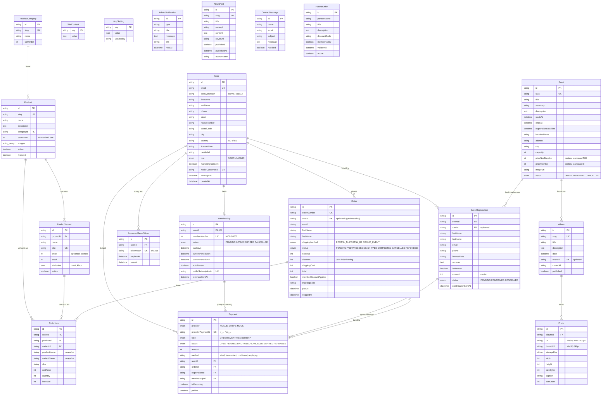

# ERD – MazdaClub Nederland

Het entity-relationship-diagram hieronder is in [Mermaid](https://mermaid.js.org/) geschreven en wordt automatisch
als diagram getoond op GitHub, GitLab en in VS Code (met de extensie *Markdown Preview Mermaid Support*).
De bron van waarheid is altijd [`prisma/schema.prisma`](../prisma/schema.prisma).

## Leeswijzer

| Symbool | Betekenis |
| --- | --- |
| `\|\|--o\|` | één-op-nul-of-één (een gebruiker heeft hooguit één lidmaatschap) |
| `\|\|--o{` | één-op-nul-of-meer |
| `\|\|--\|{` | één-op-één-of-meer (een product heeft altijd minstens één variant) |

`SiteContent`, `AppSetting`, `AdminNotification`, `NewsPost`, `ContactMessage` en `PartnerOffer` staan los: ze hebben geen relaties met andere tabellen. `EmailVerificationToken` hoort bij `User` (zoals `PasswordResetToken`); `User` heeft daarnaast `emailVerifiedAt`.
